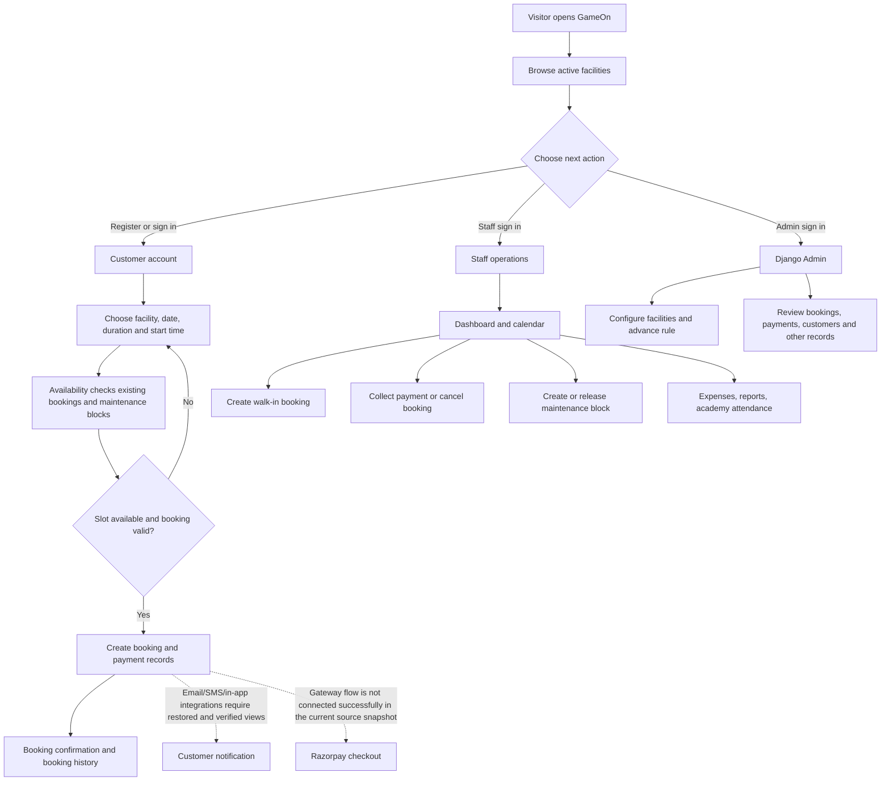
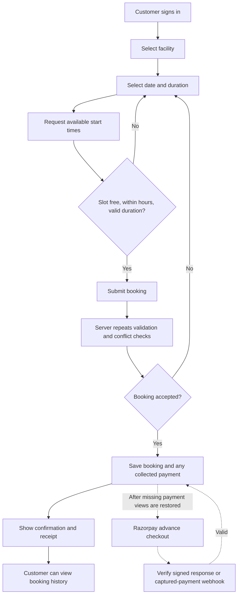
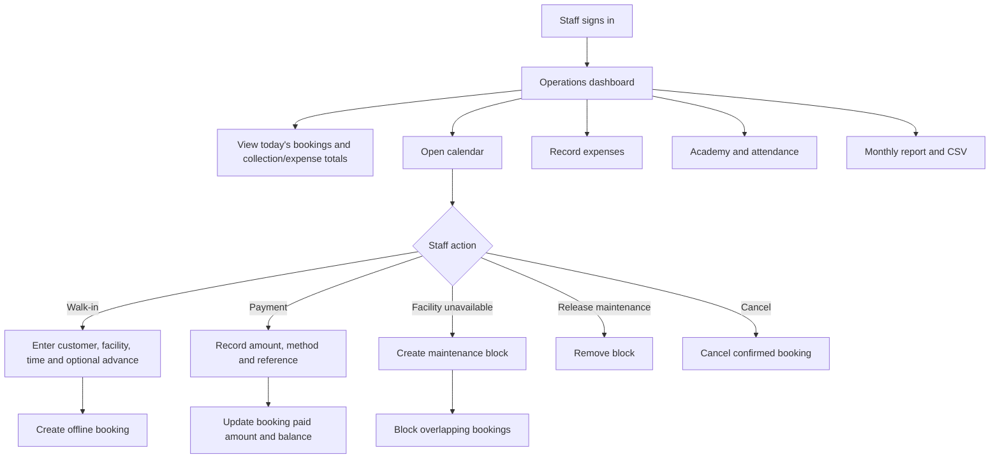
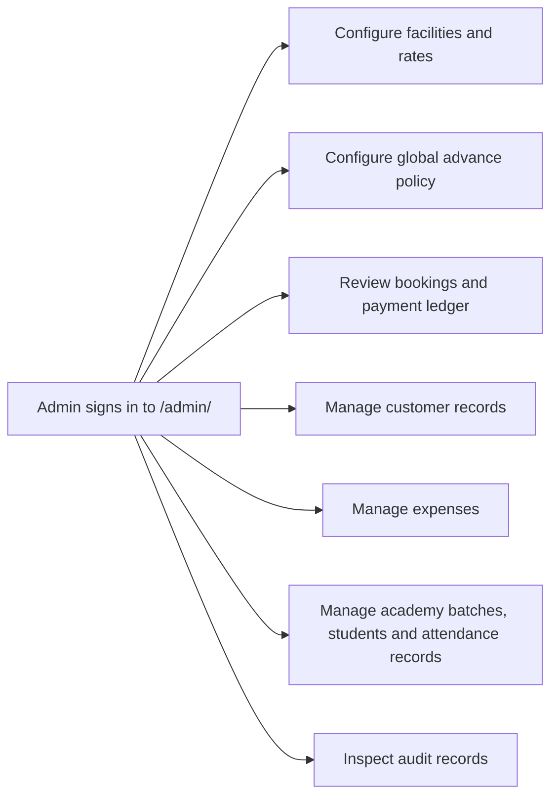

# GameOn — Project Flowchart and Client Quotation Guide

## Executive summary

GameOn is a Django web application for managing sports facilities, customer bookings, front-desk bookings, payments, operating expenses, and academy attendance. It has customer-facing booking pages, staff operations pages, and Django Admin for configuration and records.

**Important status note:** This document describes the project structure and intended product scope based on the source currently in this project folder. The current source snapshot is not ready to present as a working production system: `core/urls.py` references Razorpay and notification view functions that are absent from `core/views.py`. Running `python manage.py check` currently fails while importing the URL configuration. Treat payment checkout, the notification inbox, and the complete end-to-end product journey below as unfinished until the missing views and tests are restored and verified.

## 1. People and system parts

### User types

- **Visitor:** browses available facilities and can register or sign in.
- **Customer:** books a facility, views their bookings, and sees booking confirmation/receipt pages.
- **Staff:** uses the operations area for the dashboard, calendar, walk-in bookings, payments, maintenance blocks, expenses, academy attendance, and reports.
- **Administrator:** uses Django Admin to configure facilities and advance rules and manage or inspect application records.

Staff access is currently based on Django's `is_staff` flag. A granular role/permission system is not included.

### Main components

| Component | Responsibility |
|---|---|
| Django templates and static assets | Customer, staff, and Admin interfaces |
| `core/views.py` | HTTP routes, form handling, access checks, and page responses |
| `core/booking_services.py` | Booking creation, slot conflict checks, and maintenance blocks |
| `core/models.py` | Facilities, bookings, customers, payments, expenses, academy data, audit records, and advance settings |
| SQLite database | Local-development storage for application data |
| Razorpay integration module | Gateway order creation and payment/webhook signature verification helpers |
| Email and MSG91 module | Email and SMS confirmation delivery helpers |

## 2. Overall application flow

## 3. Customer booking flow

### Intended online flow

1. A customer registers with a mobile number and password, or signs in.
2. GameOn displays active facilities and their pricing.
3. The customer selects a facility, date, duration, and available start time.
4. The server validates duration and operating hours, then checks for overlapping confirmed bookings and maintenance blocks.
5. The server creates a booking and records any payment against the booking.
6. The customer sees booking confirmation, booking history, and a receipt containing booking/payment information.
7. A payment or booking confirmation may be delivered through email, SMS, and an in-app inbox when those routes are connected and configured.

### Availability and reservation rules

- Facilities have opening/closing times, hourly rates, and minimum/maximum booking durations.
- Availability excludes past start times, overlapping confirmed bookings, and maintenance blocks.
- The booking service repeats the conflict and operating-hour checks at submission time; the browser's availability list is not treated as the final authority.
- Booking and payment data are stored separately so multiple payments can be associated with one booking.

### Payment advance policy

The data model includes a global advance-payment setting with percentage and fixed-amount modes. The default policy is 25%; a fixed advance is capped at the booking total. The `PaymentOrder` and `advance_required` fields support a gateway payment lifecycle.

**Current implementation limitation:** although gateway helper code, URL patterns, and models exist, the current `core/views.py` does not define the checkout verification/retry/webhook handlers referenced by `core/urls.py`. The online gateway process must be repaired and tested before it is included as a delivered feature.

## 4. Staff operations flow

The front-desk booking form and customer booking flow share the booking service and database conflict checks. Staff payment collection adds a payment ledger record and updates the booking's amount paid and balance due.

## 5. Administrator flow

The admin can configure the global advance rule and facility operating/pricing data. Booking and payment records are available for operational review. The Admin interface is separate from the staff dashboard.

## 6. Main data records

| Record | Purpose |
|---|---|
| Customer | Customer name, mobile, email, and optional linked login |
| Facility | Sport, rate, operating times, duration limits, and active state |
| Booking | Facility, customer, start/end time, source, status, total, advance, and balance |
| Payment | Individual payment amount, method, reference, timestamp, direction, and recorder |
| PaymentOrder | Intended provider checkout attempts and gateway order identifiers |
| AdvancePaymentSetting | Global percentage or fixed amount for required online advances |
| MaintenanceBlock | Time range when a facility cannot be booked |
| Expense | Operating expense, method, date/time, category, and staff recorder |
| AcademyBatch / Student / Attendance | Academy groups, enrolled students, and daily attendance |
| BookingNotification | In-app booking notification record for a linked account |
| AuditLog | Recorded operational events such as booking and payment changes |

## 7. Integrations and delivery status

| Feature | Present in source | Delivery caveat |
|---|---|---|
| Email | Email helper and SMTP settings | The current booking service does not call the email helper; wire it into confirmed-booking flow, then configure and test SMTP |
| SMS | MSG91 Flow helper and settings | The current booking service does not call the SMS helper; wire it into confirmed-booking flow, then configure and test an approved template |
| Razorpay | Gateway helper, settings, models, and URL patterns | Handler views are missing in the current snapshot; do not promise live checkout yet |
| In-app notification inbox | Notification model and URL pattern | Current view function is missing; inbox route is not functional |
| Digital receipt | Booking confirmation template | Browser print/save-as-PDF is not a server-generated invoice PDF |
| WhatsApp | Not implemented | Separate provider integration and template approval would be additional scope |
| Reports | Monthly report and CSV code | Confirm report fields and CSV behavior during acceptance testing |
| Excel/PDF exports | Not implemented as server exports | Additional work if specifically required |

The current source has a blocking consistency issue: `core/urls.py` references payment and notification handlers not defined in `core/views.py`. This was verified by running `python manage.py check`, which fails with an `AttributeError` while loading `core.urls`. Resolve this before a client demonstration or production deployment.

## 8. Recommended quotation (indicative, India)

### Do not quote it as a completed production system yet

Based on the source currently available, quote this as **completion, stabilization, and production handover of an existing MVP**, not as a finished, verified product. The payment and notification routes need to be restored, and end-to-end checks are required before acceptance.

### Suggested client quote

For a **single-organization sports booking MVP**, with the customer booking portal, staff operations, Django Admin, Razorpay, email/SMS, basic reports, receipt, production deployment, documentation, and UAT:

> **Suggested fixed project fee: ₹1,75,000 + applicable taxes**
>
> **Expected delivery: 4–6 weeks after requirements sign-off and receipt of provider credentials/content.**

This is an indicative independent-developer estimate, not a market survey or binding offer. Adjust it after a client discovery meeting. A sensible negotiation range for this bounded scope is **₹1,40,000–₹2,20,000 + taxes**.

### Estimate assumptions

- One business/organization and one deployment; multiple facilities are configured as data, not separate branded tenants.
- Existing source code and local development data are supplied by the client and can be legally transferred.
- Standard customer/staff/Admin flows; no custom mobile apps.
- Client supplies the Razorpay account, approved MSG91 SMS template/account, SMTP account, logo, and final business rules.
- One agreed deployment environment, database backup setup, and basic monitoring/logging.
- Includes defect fixes found during agreed UAT and a **30-day post-handover bug-fix period**; enhancements are separately quoted.
- External services are billed to the client: hosting/domain, payment gateway charges, SMS/email usage, taxes, and any provider onboarding fees.

### Suggested milestone payments

| Milestone | Share | Amount at ₹1,75,000 |
|---|---:|---:|
| Scope sign-off and kickoff | 30% | ₹52,500 |
| Booking/staff/Admin stabilization demo | 30% | ₹52,500 |
| Payment, notification, and UAT acceptance | 30% | ₹52,500 |
| Production handover and documentation | 10% | ₹17,500 |

### Quote separately or mark as excluded

- WhatsApp Business integration and template/provider onboarding.
- Native Android/iOS apps, OTP login, or customer self-service refund flows.
- Multi-tenant support, multiple permission tiers, or complex staff roles.
- Server-generated tax-compliant PDF invoices, GST calculations, or accounting integrations.
- Excel export, advanced analytics, custom CRM, or third-party sports/ERP integrations.
- High-availability infrastructure, large-scale load testing, formal security audit, or 24/7 support.
- Historical-data cleanup or migration beyond the agreed local/demo database.

### Discovery questions before making a binding offer

1. Is this for one facility business or a SaaS product for many unrelated businesses?
2. How many facilities, staff accounts, expected bookings per day, and locations/time zones?
3. Must Razorpay be live at launch, and which payment/refund rules are required?
4. Are WhatsApp, a tax invoice number/GST, or server-generated downloadable PDF mandatory?
5. Who pays for hosting and provider usage, and what support/SLA is expected after launch?

## 9. Client-facing one-minute explanation

> “GameOn lets customers browse sports facilities, choose an available slot, book it, and view the booking/payment receipt. Staff can manage the daily calendar, create walk-in bookings, collect balances, block unavailable facility time, record expenses, and manage academy attendance. Administrators control facility pricing and the advance-payment policy and can inspect bookings and payment records. Email and SMS helper code exists but still needs to be connected to booking confirmation; WhatsApp is not included. Before production, we must restore and verify the payment and notification routes currently missing from the source snapshot, configure the provider accounts, and complete deployment and user acceptance testing.”
